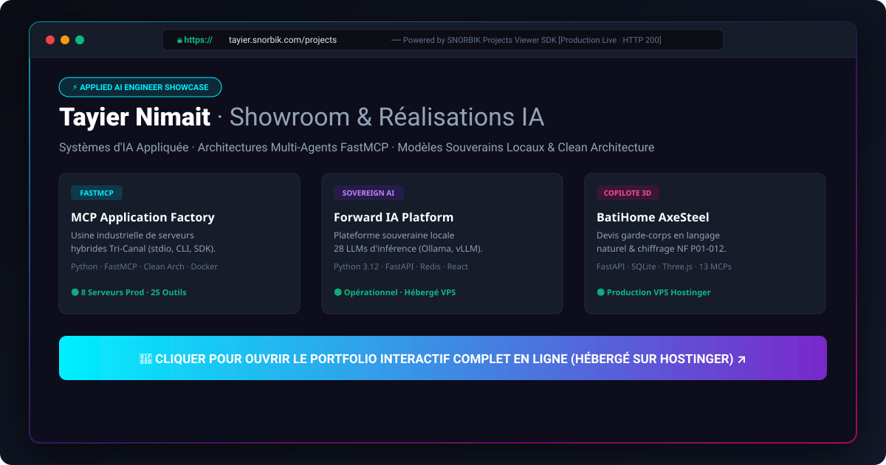

# SNORBIK Projects Viewer SDK — Multi-Distribution Portfolio Integration



> **Composant d'intégration sécurisé et multi-distribution pour embarquer et piloter le portfolio SNORBIK dans des conteneurs tiers, applications web et IDEs d'ingénierie IA.**

---

## Vocation du Produit

**SNORBIK Projects Viewer SDK** est une brique logicielle industrielle permettant d'intégrer le showroom de production hébergé sur Hostinger (`tayier.snorbik.com`, `snorbik.com`) dans n'importe quel environnement client (applications React, dashboards partenaires, extensions de navigateur, pipelines d'ingénierie IA).

Elle garantit une **isolation hermétique**, une politique de sécurité **fail-closed** et une **observabilité en temps réel** sans jamais exposer de données sensibles.

---

## Les 4 Distributions Officielles

| Canal | Format | Rôle & Usage |
| :--- | :--- | :--- |
| 📦 **Web SDK** | React `<ProjectsViewer />` & Vanilla JS | Intégration iframe sandboxée responsive dans des applications clientes |
| 🤖 **Serveur FastMCP** | `25-projects-viewer-sdk` (JSON-RPC stdio) | 6 outils de diagnostic, validation d'origines et génération d'extraits pour agents IA |
| 💻 **CLI Terminal** | `snorbik-projects-viewer` | Outil en ligne de commande pour tests réseau, sondes CSP et génération de snippets |
| 🧩 **Extension Navigateur** | Chrome / Edge Side Panel | Volet latéral d'inspection rapide et accès nomade au showroom |

---

## Invariants de Sécurité Inviolables

- **Source de Vérité Unique** : L'instance en production sur Hostinger reste la référence exclusive.
- **Fail-Closed HTTPS** : Rejet immédiat de toute URL non chiffrée ou non autorisée dans la liste blanche.
- **Iframe Sandboxée** : Permissions minimales (`allow-scripts allow-same-origin allow-popups allow-forms`) sans élévation de privilèges.
- **Zéro Secret / Zéro Donnée Sensible** : Aucun jeton d'authentification ou donnée privée ne transite par les URLs, les logs ou les prompts LLM.

---

## Exemple d'Intégration React

```tsx
import React from 'react';
import { ProjectsViewer } from '@snorbik/projects-viewer-sdk';

export const MyPortfolioContainer: React.FC = () => {
  return (
    <ProjectsViewer
      sourceUrl="https://tayier.snorbik.com/projects"
      title="Showroom Réalisations IA SNORBIK"
      fallbackUrl="https://tayier.snorbik.com"
      minHeight={800}
    />
  );
};
```

---

## Découvrir l'Écosystème & Démos Live

Cette vitrine présente l'architecture publique d'un composant de la suite **SNORBIK AI**.  
L'implémentation complète du moteur d'exécution est maintenue dans un dépôt privé protégé.

- 🧪 **Showroom Déployé en Production :** [https://tayier.snorbik.com](https://tayier.snorbik.com)
- 📄 **CV Interactif Ingénieur IA :** [https://tayier.snorbik.com/cv](https://tayier.snorbik.com/cv)
- 🏢 **Studio B2B SNORBIK :** [https://snorbik.com](https://snorbik.com)

---

© 2026 **SNORBIK AI** — Tous droits réservés. Showcase public officiel.
